<div align="center">

  <!-- Animated Blur Reveal SVG Hero Banner -->
  <a href="https://github.com/parth7123/Whatsgrow">
    
  </a>

  <br />
  <br />

  <!-- Animated Typing SVG Subtitle -->
  <a href="https://git.io/typing-svg">
    
  </a>

  <br />
  <br />

  <!-- Animated Flat Badges -->
  <p align="center">
    <a href="https://github.com/parth7123/Whatsgrow"></a>
    
    
    
    
    
  </p>

  <!-- Navigation Links -->
  <p align="center">
    <a href="#-overview"><b>⚡ Overview</b></a> •
    <a href="#-quick-start"><b>🚀 Quick Start</b></a> •
    <a href="#-key-features"><b>🎯 Features</b></a> •
    <a href="#-architecture--tech-stack"><b>🛠 Tech Stack</b></a> •
    <a href="#-api-examples"><b>📡 API Reference</b></a> •
    <a href="#-security"><b>🔒 Security</b></a>
  </p>

</div>


## ⚡ Overview

**WhatsGrow** is an enterprise-grade, high-performance **WhatsApp Automation & Marketing API Gateway**. Designed for businesses, agencies, and developers, it provides a self-hosted messaging infrastructure with **zero vendor lock-in**, **no per-message fees**, and **complete data privacy**.

```
 ┌─────────────────┐       ┌─────────────────┐       ┌─────────────────┐
 │   REST API      │ ───►  │   WhatsGrow     │ ───►  │  WhatsApp Web / │
 │   & Dashboard   │       │   Core Engine   │       │     Baileys     │
 └─────────────────┘       └─────────────────┘       └─────────────────┘
                                    │
                       ┌────────────┴────────────┐
                       ▼                         ▼
            ┌─────────────────────┐   ┌─────────────────────┐
            │ SQLite / Postgres   │   │ Local / S3 Media    │
            └─────────────────────┘   └─────────────────────┘
```

### ✨ Highlights at a Glance

- 🔓 **100% Self-Hosted & Open**: You hold the keys, session files, and database — zero monthly software subscriptions.
- 📱 **Multi-Session Engine**: Run unlimited WhatsApp sessions simultaneously on a single lightweight deployment.
- 🏗️ **Pluggable Architecture**: Effortlessly swap database backends (SQLite / PostgreSQL), media storage (Local / S3 / MinIO), and caching (Memory / Redis) through configuration.
- 🖥️ **Bundled React Admin Dashboard**: High-performance dashboard included right out-of-the-box for QR pairing, chat monitoring, webhook logs, and key control.
- 🤖 **AI Ready (MCP Protocol)**: Native Model Context Protocol (MCP) server support built-in for AI agents like Claude Code and Cursor.


## 🛠 Tech Stack

<div align="center">
  <a href="https://skillicons.dev">
    
  </a>
</div>

<br />

| Layer | Technologies Used |
| :--- | :--- |
| **Backend Core** | Node.js 22 LTS, NestJS 11.x, TypeScript 5.x |
| **WhatsApp Drivers** | `whatsapp-web.js` (default) & `@whiskeysockets/baileys` |
| **Frontend Dashboard** | React 18, Vite, Lucide Icons, Modern CSS |
| **Databases** | SQLite (default embedded) & PostgreSQL |
| **Storage & Cache** | Local storage, AWS S3 / MinIO, Redis |
| **DevOps** | Docker, Docker Compose, Health Checks |


## 🎯 Key Features

| Feature Area | Details & Capabilities | Status |
| :--- | :--- | :---: |
| 📩 **REST Messaging** | Send/receive text, media (images, video, documents, voice notes), stickers, & reactions | ✅ |
| 👥 **Multi-Session** | Manage concurrent sessions via QR Code scan or 8-digit Pairing Code | ✅ |
| 🪝 **Smart Webhooks** | Real-time event dispatches with HMAC signature security & pre-dispatch filtering | ✅ |
| 📊 **Admin Dashboard** | Served alongside NestJS API on the exact same port — zero extra configuration | ✅ |
| 🔑 **API Key & User Auth** | Multi-user support with Role-Based Access Control (Admin, Operator, Viewer) | ✅ |
| 📑 **Interactive Swagger** | Complete interactive API documentation at `/api/docs` | ✅ |
| 💬 **Groups & Channels** | Group management, admin roles, participant controls & WhatsApp Channels support | ✅ |
| 🏷️ **Labels & Contacts** | Sync WhatsApp Business labels and manage contacts programmatically | ✅ |
| 🤖 **MCP AI Integration** | Stateless Streamable-HTTP Model Context Protocol for AI Agent tools | ✅ |


## 🚀 Quick Start

### Option A: Docker Compose (Recommended)

Start the entire WhatsGrow stack in seconds:

```bash
# 1. Clone the repository
git clone https://github.com/parth7123/Whatsgrow.git
cd Whatsgrow

# 2. Launch with Docker Compose
docker compose -f docker-compose.dev.yml up -d
```

#### Access Points:
- 📊 **Web Dashboard**: [http://localhost:2785](http://localhost:2785)
- 📚 **Swagger Docs**: [http://localhost:2785/api/docs](http://localhost:2785/api/docs)
- 🔌 **API Endpoint**: `http://localhost:2785/api`

---

### Option B: Local Node.js Development

```bash
# 1. Clone repository
git clone https://github.com/parth7123/Whatsgrow.git
cd Whatsgrow

# 2. Install backend and dashboard dependencies
npm install

# 3. Start development mode (Hot-reload API + Hot-reload Vite Dashboard)
npm run dev
```

#### Local Ports:
- 📊 **Dashboard (Vite)**: [http://localhost:2886](http://localhost:2886)
- ⚡ **API Gateway**: [http://localhost:2785](http://localhost:2785)


## 📡 API Reference & Code Examples

<details>
<summary><b>1. Create a WhatsApp Session</b> (Click to expand)</summary>

```bash
curl -X POST http://localhost:2785/api/sessions \
  -H "Content-Type: application/json" \
  -H "X-API-Key: YOUR_API_KEY" \
  -d '{
    "name": "sales-bot"
  }'
```
</details>

<details>
<summary><b>2. Start Session & Get QR Code</b> (Click to expand)</summary>

```bash
# Start session
curl -X POST http://localhost:2785/api/sessions/{sessionId}/start \
  -H "X-API-Key: YOUR_API_KEY"

# Fetch QR Code
curl http://localhost:2785/api/sessions/{sessionId}/qr \
  -H "X-API-Key: YOUR_API_KEY"
```
</details>

<details>
<summary><b>3. Send Text & Media Message</b> (Click to expand)</summary>

```bash
curl -X POST http://localhost:2785/api/sessions/{sessionId}/messages/send-text \
  -H "Content-Type: application/json" \
  -H "X-API-Key: YOUR_API_KEY" \
  -d '{
    "chatId": "1234567890@c.us",
    "text": "Hello from WhatsGrow API! 🚀"
  }'
```
</details>

<details>
<summary><b>4. Setup Real-time Webhooks</b> (Click to expand)</summary>

```bash
curl -X POST http://localhost:2785/api/sessions/{sessionId}/webhooks \
  -H "Content-Type: application/json" \
  -H "X-API-Key: YOUR_API_KEY" \
  -d '{
    "url": "https://your-domain.com/webhook",
    "events": ["message.received", "session.status"],
    "secret": "your-hmac-secret-key"
  }'
```
</details>


## 🔒 Security Architecture

- 🛡️ **Unprivileged Container User**: Docker images run under a dedicated `whatsgrow` unprivileged user.
- 🔒 **Docker Socket Isolation**: Host daemon is isolated behind a restricted TCP proxy sidecar.
- 🔑 **Bcrypt Salted API Keys**: Raw API key secrets are never stored in plain text.
- 🌐 **CIDR IP Whitelisting**: Lock down API keys to trusted corporate IP ranges.


## 📄 License

Licensed under the **MIT License**. Free for personal, open-source, and commercial projects.

See [LICENSE](./LICENSE) for details.

---

<div align="center">

**WhatsGrow** – Self-Hosted WhatsApp Automation &amp; Marketing API Gateway

</div>
