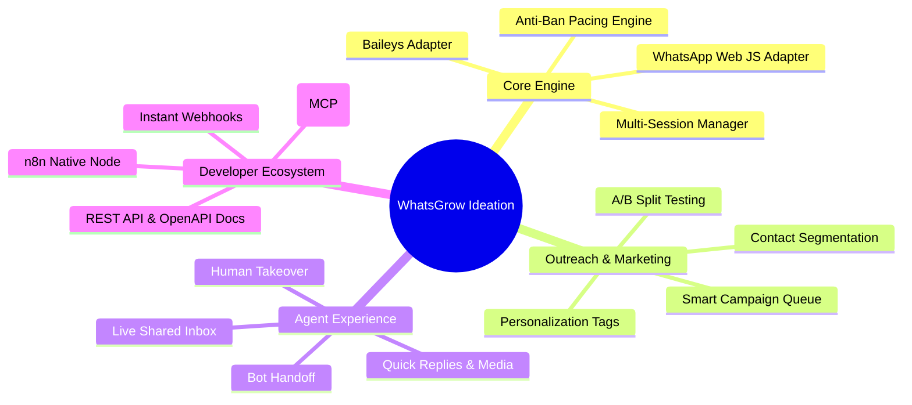
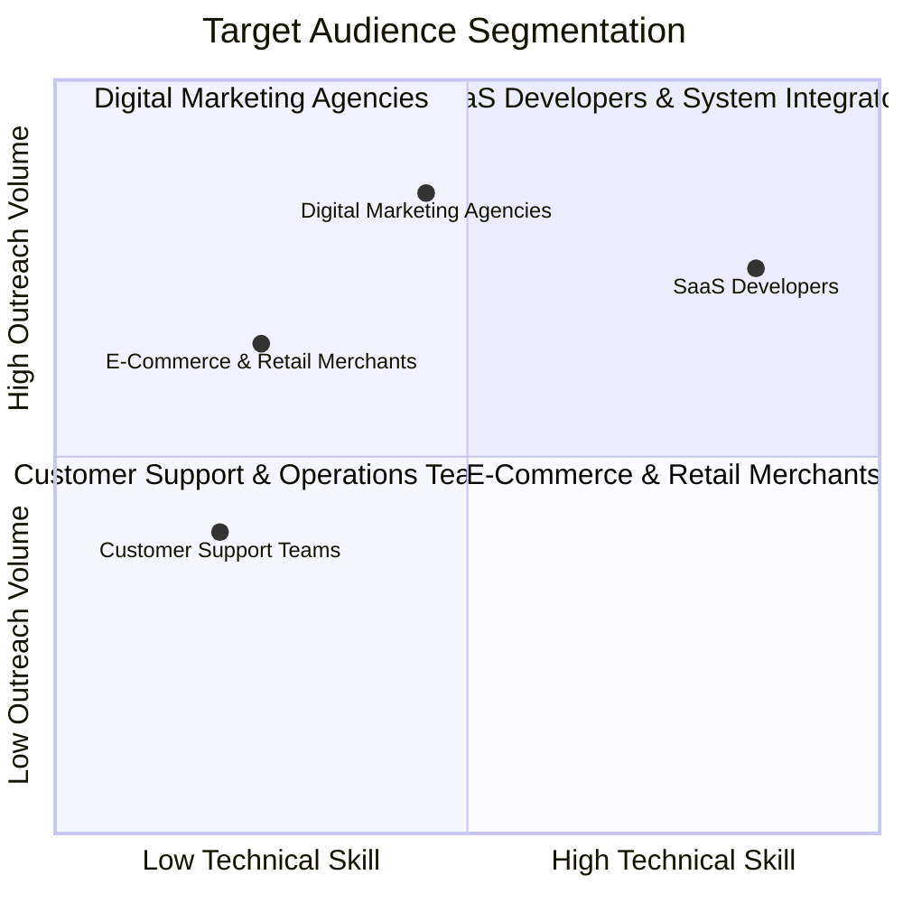

# 25 - Requirements Gathering Framework & Core Q&A Specification

> **Product**: WhatsGrow (Le Choix des Marques) / OpenWA  
> **Document Purpose**: Provides a complete Requirements Gathering Framework (Questionnaire, Brainstorming Framework, User Survey Instrument) along with an authoritative Core Q&A Specification (Purpose & Scope, Targeted Audience Personas, and Content Delivery Matrix) for the WhatsGrow enterprise WhatsApp automation and orchestration platform.

---

# PART 1: REQUIREMENTS GATHERING FRAMEWORK

---

## 1. Structured Requirements Questionnaire

This questionnaire is designed to elicit functional, non-functional, business, and operational requirements from project stakeholders, product managers, developers, and client partners.

### 1.1 General Vision & Business Strategy
1. **What is the primary business goal of deploying WhatsGrow?**
   - [ ] Bulk marketing and outreach campaigns
   - [ ] Customer support and live agent inbox
   - [ ] Transactional messaging (OTPs, order updates, booking confirmations)
   - [ ] Developer infrastructure / API backend for third-party products
2. **What volume of outgoing messages does the platform need to handle daily/monthly per account?**
3. **What is the target SLA for message dispatch and webhook latency?** (e.g., < 50ms webhook response, < 1s delivery dispatch)
4. **What deployment topology is required?**
   - [ ] Multi-tenant Cloud SaaS (Hosted platform)
   - [ ] On-Premise / Self-Hosted Docker deployment
   - [ ] Hybrid (Cloud control plane + local session runners)

### 1.2 Session Management & Connection Reliability
1. **How many concurrent WhatsApp sessions (phone numbers) need to be connected per account/organization?**
2. **How should QR code authentication be handled for non-technical team members?**
   - [ ] Web Dashboard inline QR scan
   - [ ] Pair Code (8-character phone number pairing code)
   - [ ] Remote scanning link for external clients
3. **What is the expected auto-reconnection behavior if a phone loses internet or WhatsApp Web disconnects?**
4. **Should session states be persisted in SQLite, PostgreSQL, or Redis?**
5. **How should session failures or phone battery/network drops be alerted to admins?** (e.g., Email, Slack, Webhook alert, Dashboard banner)

### 1.3 Outbound Campaigns & Automation Engine
1. **What types of campaign triggers are required?**
   - [ ] Manual CSV/VCF bulk list upload
   - [ ] Webhook-triggered single/batch dispatches
   - [ ] Scheduled cron jobs (e.g., send every Tuesday at 10 AM)
   - [ ] Event-driven workflow triggers (e.g., n8n, Zapier, Make, MCP)
2. **What anti-ban safeguards and rate limits must be configured by default?**
   - Minimum delay between messages (e.g., 3-7 seconds randomized)
   - Daily message cap per WhatsApp number
   - Warm-up schedule for new WhatsApp accounts
   - Blacklist / Opt-Out handling ("STOP" auto-unsubscribe)
3. **How should message template variables (`{{name}}`, `{{order_id}}`, `{{custom_1}}`) be mapped and validated prior to launch?

### 1.4 Interactive Live Inbox & Support Operations
1. **How many support agents will simultaneously use the shared chat inbox?**
2. **What conversation assignment rules are needed?**
   - [ ] Manual assignment to specific agents
   - [ ] Round-robin automated distribution
   - [ ] Bot-first with human takeover button
3. **What canned responses, quick replies, and rich media templates are required for agents?**
4. **Should chat conversations support internal agent notes and contact tagging (`#VIP`, `#Lead`, `#Support`)?**

### 1.5 API, Webhooks & Ecosystem Integration
1. **What authentication mechanism should be enforced for developer API calls?**
   - [ ] API Key in headers (`X-API-Key`)
   - [ ] Bearer JWT tokens with scope-based permissions
   - [ ] IP Whitelisting
2. **Which webhook events must external systems subscribe to?**
   - `message.received`, `message.ack` (sent/delivered/read), `session.status_change`, `campaign.completed`, `qr.updated`
3. **What retry policy and DLQ (Dead Letter Queue) mechanism is expected for failing webhooks?**
4. **Are official integrations required for tools like n8n, Make.com, HubSpot, Shopify, or WooCommerce?**

### 1.6 Security, Compliance & Data Governance
1. **Where should message history and media files be stored, and for how long?**
2. **Is end-to-end data encryption required for stored credentials and session tokens on disk?**
3. **What Role-Based Access Control (RBAC) tiers are necessary?** (e.g., Super Admin, Tenant Admin, Agency Client, Support Agent, API Developer)
4. **What regional privacy regulations apply (GDPR, CCPA, HIPAA)?**

---

## 2. Brainstorming Framework & Feature Ideation

This section outlines brainstorming concepts, technical architectural evaluations, and future feature expansion paths.



### 2.1 Core Problem vs. Solution Brainstorming
| Challenge / Pain Point | Traditional WhatsApp Tools | WhatsGrow Brainstormed Solution |
| :--- | :--- | :--- |
| **Number Banning** | High ban rate due to burst sending without delays. | **Smart Pacing Engine**: Adaptive delay randomization, warm-up pacing, and quota management. |
| **Slow Dashboard UI** | Laggy multi-tab switching, slow page updates. | **0ms Tab Switching**: Reactive frontend (React/Vite) with instant local state caching. |
| **Vendor Lock-In** | Expensive Cloud API per-message fee structures. | **Dual Engine Support**: Multi-session Baileys/Puppeteer engine with zero per-message cost. |
| **Integration Complexity** | Clunky webhooks, missing developer docs. | **Developer-First OpenAPI Specs**: Pre-built cURL, Node.js, Python SDKs, and n8n nodes. |

### 2.2 Feature Expansion & Future Roadmap Ideation
1. **AI-Powered Conversation Assistant**:
   - OpenAI / Claude LLM integration for automated customer support replies.
   - Retrieval-Augmented Generation (RAG) over company documentation to answer FAQs automatically.
2. **Interactive WhatsApp Message Formats**:
   - Native support for Interactive Button Messages, Select Lists, Template Buttons, and Location Cards.
3. **WhatsApp Automation Workflow Builder**:
   - Visual drag-and-drop flow builder (similar to ManyChat / Typebot) directly integrated inside the WhatsGrow dashboard.
4. **Multi-Channel Fallback**:
   - If WhatsApp message delivery fails or contact is not on WhatsApp, fallback automatically to SMS or Email via Twilio/SendGrid.

---

## 3. User & Customer Survey Instrument

This survey instrument is designed to gather insights from prospective users (e-commerce merchants, agencies, developers, support managers).

### 3.1 Survey Target Demographics
- **Group 1**: E-Commerce Founders & Store Managers
- **Group 2**: Marketing & Growth Agency Owners
- **Group 3**: Software Engineers & Technical Product Managers
- **Group 4**: Customer Support & Operations Leads

### 3.2 Survey Questions

#### Section A: Current WhatsApp Usage & Pain Points
1. **How do you currently communicate with customers on WhatsApp?**
   - [ ] WhatsApp Business App on a single smartphone
   - [ ] Official WhatsApp Cloud API (e.g., WATI, Interakt, Twilio)
   - [ ] Custom open-source script (e.g., Baileys, whatsapp-web.js)
   - [ ] We do not currently use WhatsApp
2. **What is your biggest frustration with existing WhatsApp automation tools?** *(Select top 2)*
   - [ ] Expensive per-message pricing models
   - [ ] Frequent number bans / account suspensions
   - [ ] Inability to connect multiple phone numbers under one account
   - [ ] Poor developer APIs and slow webhooks
   - [ ] Lack of a unified team inbox for support agents
   - [ ] Clunky and slow dashboard user interface

#### Section B: Feature Value Ranking
Rate the importance of the following features on a scale of 1 to 5 (1 = Low Value, 5 = Critical):
- **Multi-Session Orchestration** (Managing 5 to 50+ WhatsApp numbers from 1 dashboard): `[ 1 | 2 | 3 | 4 | 5 ]`
- **Smart Anti-Ban Campaign Dispatcher** (Bulk messaging with randomized delays): `[ 1 | 2 | 3 | 4 | 5 ]`
- **0ms Instant UI Navigation & Real-Time Inbox**: `[ 1 | 2 | 3 | 4 | 5 ]`
- **Zero Per-Message Cost (Self-hosted or flat SaaS fee)**: `[ 1 | 2 | 3 | 4 | 5 ]`
- **n8n / Zapier / MCP Automation Nodes**: `[ 1 | 2 | 3 | 4 | 5 ]`

#### Section C: Pricing & Delivery Preferences
1. **What pricing structure would you prefer for an enterprise WhatsApp platform?**
   - [ ] Flat Monthly SaaS Subscription (Unlimited messages, pay per connected session)
   - [ ] Usage-based pricing per sent message
   - [ ] One-Time Lifetime License for Self-Hosting (Docker/Node.js)
2. **How much would your organization be willing to pay monthly for a platform managing 5 active WhatsApp numbers?**
   - [ ] $29 - $49 / month
   - [ ] $49 - $99 / month
   - [ ] $99 - $249 / month
   - [ ] $250+ / month

---

# PART 2: CORE Q&A SPECIFICATION

---

## 4. What is the Purpose and All? (Vision, Purpose & Architecture)

### 4.1 Vision Statement
To empower businesses, agencies, and developers with an enterprise-grade, high-performance WhatsApp orchestration platform that turns WhatsApp into a scalable outreach, marketing, customer support, and automated transaction engine with zero message markups and complete operational control.

### 4.2 Core Purpose & Problem Statement

#### The Problem
Modern businesses struggle to scale customer engagement on WhatsApp due to key technical and operational hurdles:
1. **The Single-Device Bottleneck**: Standard WhatsApp Business apps limit multi-agent scaling across team members.
2. **High Cloud API Costs**: The official Meta Cloud API imposes per-conversation charges that scale exponentially as campaign volumes grow.
3. **Number Suspensions (Bans)**: Unregulated bulk senders trigger spam detection, causing sudden account bans and lost customer relationships.
4. **Siloed Systems**: Connecting WhatsApp to existing CRMs, ERPs, e-commerce stores, and webhooks is often complex, brittle, or requires custom engineering.

#### The WhatsGrow Purpose
WhatsGrow solves these challenges by serving as an all-in-one **WhatsApp Session Orchestrator, Bulk Campaign Dispatcher, and Live Team Inbox**. Key solutions provided:
- **Session Decoupling**: Connect and control multiple WhatsApp accounts simultaneously via multi-session QR pairing.
- **Built-In Anti-Ban Technology**: Employs human-like dispatch pacing, adaptive queue throttling, variable tag personalization, and opt-out processing.
- **Developer-First Infrastructure**: Provides zero-latency REST APIs, instant WebSocket/HTTP webhooks, and native integration components (n8n, MCP) so any codebase can send and receive WhatsApp messages in minutes.
- **Lightning-Fast User Experience**: Built with modern frontend tooling (React, Vite, CSS design tokens) providing 0ms tab switching and real-time inbox synchronization.

### 4.3 High-Level System Architecture Summary

```
                      +----------------------------------+
                      |     WhatsGrow Web Dashboard      |
                      |   (React / Vite / Live Inbox)    |
                      +----------------------------------+
                                       |
                                  REST / WS
                                       v
                      +----------------------------------+
                      |      NestJS Core Controller      |
                      | (Session Mgr, Campaign Engine)   |
                      +----------------------------------+
                                  /          \
                                 /            \
                                v              v
         +--------------------------+    +--------------------------+
         | WhatsApp Engine Adapters |    | Storage & Queue Layer    |
         | (whatsapp-web.js /       |    | (SQLite / PostgreSQL /   |
         |  Baileys Multi-Session)  |    |  In-Memory Message Queue)|
         +--------------------------+    +--------------------------+
                      |                             |
                      v                             v
           WhatsApp Network / Web            External Webhooks /
           Target Customer Devices           n8n / Client Apps
```

---

## 5. Targeted Audience & User Personas

WhatsGrow serves four primary target audience segments. Each segment has distinct operational needs, technical proficiencies, and usage goals.



### 5.1 Persona 1: E-Commerce & Retail Merchants
- **Profile**: Store owners, e-commerce managers, growth marketers running Shopify, WooCommerce, or custom online stores.
- **Primary Goals**:
  - Automatically send order confirmations, shipping updates, and delivery tracking alerts.
  - Recover abandoned carts with personalized discount vouchers.
  - Run promotional broadcasts for sales events (e.g., Black Friday, product launches).
- **Key Pain Points**: High cart abandonment rates, low email open rates (15-20% vs WhatsApp's 95%+), expensive SMS charges.
- **How WhatsGrow Delivers**: Webhook-triggered transactional messages, dynamic parameter insertion (`{{first_name}}`, `{{cart_link}}`), and CSV list broadcasts.

### 5.2 Persona 2: Digital Marketing & Growth Agencies
- **Profile**: Marketing agencies managing lead generation, client communications, and multi-brand campaigns.
- **Primary Goals**:
  - Manage multiple client WhatsApp numbers from a single central management console.
  - White-label campaign reports for client transparency.
  - Protect client phone numbers from bans while executing high-volume outreach campaigns.
- **Key Pain Points**: Juggling multiple physical phones, lack of agency multi-tenancy, risk of client account suspensions.
- **How WhatsGrow Delivers**: Multi-Session Orchestration, granular API keys per client workspace, anti-ban pacing controls, and detailed audit log delivery.

### 5.3 Persona 3: Customer Support & Operations Teams
- **Profile**: Support team leads, customer success managers, and live chat agents.
- **Primary Goals**:
  - Provide a shared, multi-agent inbox where support representatives can collaborate on incoming customer inquiries.
  - Seamlessly hand off conversations between automated AI bots and human agents.
  - Apply tags, internal agent notes, and canned quick responses for fast resolution.
- **Key Pain Points**: Customers sending messages to personal agent phones, delayed response times, lack of central conversation history.
- **How WhatsGrow Delivers**: Interactive Live Inbox with real-time WebSockets, quick reply templates, conversation tagging, and agent takeover toggles.

### 5.4 Persona 4: SaaS Developers & Product Managers
- **Profile**: Full-stack developers, backend engineers, and technical product builders.
- **Primary Goals**:
  - Integrate WhatsApp messaging programmatically into existing web/mobile applications.
  - Receive instant HTTP webhook notifications when incoming customer messages arrive.
  - Build automated workflows using n8n, Zapier, Make, or custom Node.js/Python scripts.
- **Key Pain Points**: Complex official WhatsApp API onboarding, approval delays, strict message template pre-approvals, lack of standard SDKs.
- **How WhatsGrow Delivers**: RESTful OpenAPI / Swagger documentation, <50ms webhook event dispatch, lightweight Docker containerization, and pre-built integration nodes.

---

## 6. What Kind of Content is Delivered?

WhatsGrow handles a rich spectrum of data payloads, media formats, workflow notifications, integration events, and analytics reports.

### 6.1 WhatsApp Message Formats & Media Payloads
The platform supports all native WhatsApp message formats across incoming and outgoing streams:

| Content Category | Specific Formats Delivered | Payload & Technical Example |
| :--- | :--- | :--- |
| **Plain & Formatted Text** | UTF-8 text with full emoji support, bold (`*text*`), italics (`_text_`), strikethrough (`~text~`), and inline code (` ```code``` `). | Standard string payload with line breaks and custom variable substitution. |
| **Rich Media Attachments** | Images (`.jpg`, `.png`, `.webp`), Videos (`.mp4`), Audio files (`.mp3`, `.ogg`, `.m4a`). | Public URL or Base64 encoded file stream with automatic thumbnail generation. |
| **Voice Notes (Paging)** | Push-to-talk native audio voice clips rendered with wave visualizers. | Audio formatted specifically as `.ogg` with Opus codec for native WhatsApp voice note playback. |
| **Documents & PDFs** | PDFs, Word documents (`.docx`), Excel spreadsheets (`.xlsx`), CSV files. | File download payload accompanied by filename and mime-type headers. |
| **Interactive Buttons** | Quick reply action buttons and CTA link buttons. | Structured JSON specifying button IDs, titles, and callback action identifiers. |
| **List Messages & Menus** | Single/Multi-select interactive option menus. | Sectioned items list with titles, descriptions, and selection callback handlers. |
| **Location & Contact Cards** | Geographic coordinates (Latitude/Longitude) and vCard contact details. | Native map location preview cards and downloadable contact cards (`.vcf`). |

### 6.2 Dynamic Personalization & Campaign Variables
Campaign payloads deliver customized text using variable interpolation tags sourced from contact lists or API requests:
- **Standard Tag Substitutions**:
  - `{{name}}` -> Contact Full Name
  - `{{phone}}` -> Destination Phone Number
  - `{{first_name}}` -> Extracted first name
- **Custom Payload Attributes**:
  - `{{order_id}}` -> e.g., `#10948`
  - `{{tracking_url}}` -> e.g., `https://brand.com/track/10948`
  - `{{discount_code}}` -> e.g., `SAVE20NOW`
  - `{{appointment_time}}` -> e.g., `Thursday at 3:00 PM`

### 6.3 Automated Event Notifications & Outbound Workflows
The platform delivers automated system notifications across critical operational workflows:
1. **E-Commerce & Transactional Triggers**:
   - Immediate order confirmation notifications.
   - Real-time shipping dispatch & tracking updates.
   - Abandoned cart recovery sequences (15 mins, 2 hours, 24 hours post-abandonment).
   - Instant OTP (One-Time Password) & account verification codes.
2. **Customer Relationship & Marketing Campaigns**:
   - Bulk promotional announcements and product drops.
   - Scheduled event reminders (webinars, appointments, renewals).
   - Re-engagement surveys & feedback collection flows.

### 6.4 Developer API & Webhook Event Payloads
For developers, WhatsGrow delivers real-time HTTP event payloads via webhooks (< 50ms latency) and WebSocket streams:
- `message.received`: Full details of incoming customer messages (sender ID, text, media download links, timestamp).
- `message.ack`: Delivery receipts (`PENDING`, `SERVER_ACK`, `DELIVERED`, `READ`).
- `session.status_change`: Real-time account connectivity states (`CONNECTING`, `QR_REQUIRED`, `AUTHENTICATED`, `DISCONNECTED`).
- `campaign.progress`: Live campaign metrics updates (`total`, `sent`, `failed`, `remaining`).

### 6.5 Analytics, Reporting & Dashboard Content
The platform delivers operational intelligence and business metrics via visual charts, data tables, and downloadable exports:
- **Deliverability Metrics**: Sent count, delivered count, read rate, failed message count, and anti-ban delay pacing charts.
- **Session Health Metrics**: Connection uptime graphs, battery/signal status, socket latency, and active session count.
- **Agent Performance Metrics**: Average response time per agent, resolved conversations, total chats handled per day.
- **Export Formats**: One-click CSV and JSON exports of contact lists, campaign performance history, and audit log entries.

---

## 7. Conclusion & Next Steps

This document serves as the foundational reference for project requirements, technical specs, stakeholder alignment, and customer outreach.

### Suggested Immediate Actions:
1. **Stakeholder Questionnaire Review**: Execute the questionnaire in Section 1 with core engineering, product, and sales leads.
2. **Survey Deployment**: Send the survey instrument in Section 3 to beta users, agency partners, and target e-commerce merchants.
3. **Architecture & Feature Implementation**: Reference Part 2 Q&A specifications during sprint planning and feature development for WhatsGrow.
